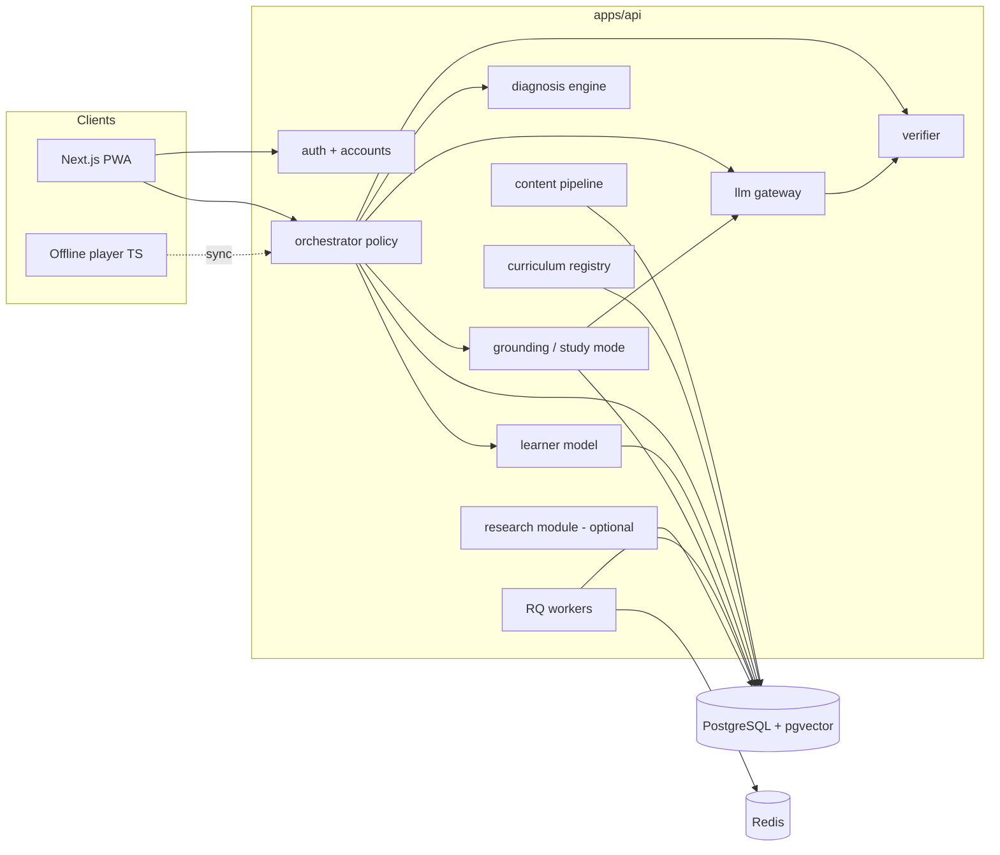
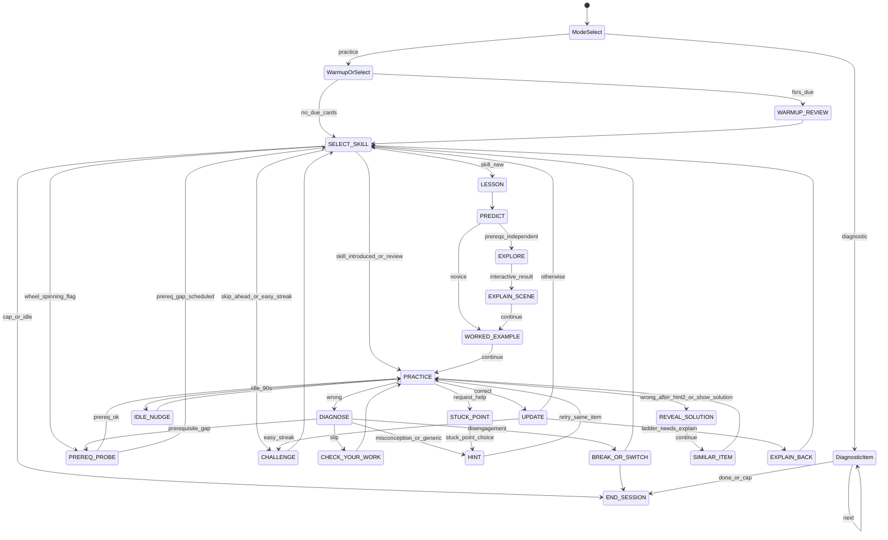
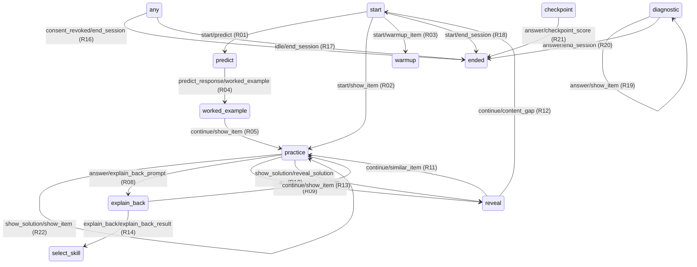

# ARCHITECTURE — Pedagogy-First AI Tutor (v2)

The orchestrator decides pedagogy. The textbook decides content. The LLM only phrases. Correctness, next skill, mastery, and answer reveal are never delegated to a model.

v2 is region-neutral: curricula, languages, time zones, legal rules and hosting region are configuration, not code. v1 behaviour that is already built (M0–M5.5) is preserved unless a section says otherwise; changes are marked **[v2]**.

---

## 0. Design sources


| Decides                | Source of truth                                                                   | Section |
| ---------------------- | --------------------------------------------------------------------------------- | ------- |
| WHAT is taught         | Curriculum registry + approved content (skills, items, lessons, passages)         | §6, §17 |
| HOW it is taught       | Deterministic policy built from learning-science rules (tutor constitution)       | §8–§10  |
| HOW it is personalised | Student model: mastery ladder, misconceptions, prerequisite gaps, review schedule | §11     |
| HOW it is worded       | LLM phrasing layer, constrained by an instruction object and post-checks          | §14     |
| WHETHER it is correct  | Verifier (allowlist parser + SymPy / exact / MCQ / widget goal predicates)        | §13     |
| How the tutor behaves (tone, escalation, ask-before-tell) | **`docs/TUTOR_CONSTITUTION.md`** | §8–§10, §14 |


---

## 1. Principles

1. **Deterministic teaching engine.** `policy(learner, session, last_event) → action` is pure and unit-tested. No I/O inside it.
2. **LLM is a phrasing layer.** It receives a narrow instruction object. It never chooses the next skill, scores an answer, or decides when to reveal.
3. **Verified truth only.** Correctness comes from the verifier. Explanations are grounded in authored steps or cited passages. Explain-back grades are formative only.
4. **Ask before telling. [v2]** The default response to a wrong or stuck student is a diagnostic move (a structured "where are you stuck?" choice or a targeted question), not an explanation.
5. **Smallest sufficient help. [v2]** Help escalates one level at a time: orient → strategy → step → worked parallel example → reveal + similar item.
6. **Correct ≠ mastered. [v2]** Mastery is a ladder (§11.2). A skill only reaches *Solid* after delayed recall.
7. **Grounded or silent. [v2]** In Study Mode every factual statement cites a passage in the selected book/section, or the tutor says it is outside the material.
8. **Same guardrails online and offline.** Shared JSON fixtures are contract tests for the Python orchestrator and the TypeScript offline player.
9. **Children's data minimal by default.** No PII in LLM prompts or `llm_calls`. Legal requirements come from a jurisdiction profile (§19), not hard-coded rules.
10. **Works without an API key.** Authored hints, solutions, lesson scenes and encouragement copy are always sufficient.
11. **Approved content only in production.** Runtime serves `status=approved` unless `ALLOW_DRAFT_CONTENT=true`. A chapter goes live only when §17.4 thresholds pass.
12. **Locale fallback.** Missing or placeholder translations fall back along the locale's fallback chain to the default locale. Never show empty fields or unreviewed machine translation.
13. **Region-neutral. [v2]** No country, board, language or time zone appears in code as an enum or constant. All are registry data.

---

## 2. System context




Hosting region is a deployment setting chosen by the jurisdiction profile's data-residency rule (§19). Not part of MVP.

---

## 3. Repository layout

```
/
├─ PLAN.md
├─ ARCHITECTURE.md
├─ docker-compose.yml
├─ .env.example
├─ .gitattributes
├─ apps/
│  ├─ api/            FastAPI: orchestrator, diagnosis, verifier, learner, grounding, LLM gateway
│  └─ web/            Next.js App Router PWA: student, parent, teacher, admin
├─ config/            [v2] locales.yaml, grade_bands.yaml, notation_profiles.yaml, jurisdictions/*.yaml (G0)
├─ content/
│  ├─ curricula/      [v2] <curriculum_id>/curriculum.yaml → books → chapters (G0; sections later)
│  ├─ skills/  items/  misconceptions/  glossary/  templates/
│  ├─ lessons/        [v2] lesson beats, whiteboard scene scripts, widget specs
│  └─ passages/       [v2] grounded source text with provenance + licence
├─ evals/             LLM, grounding, pedagogy and language eval suites
└─ packages/shared/   OpenAPI TS types, contract fixtures, widget + scene schemas, generated/locales.json (G0)

```

Python 3.12, Pydantic v2, SQLAlchemy 2, Alembic, Postgres 16 + pgvector, Redis + RQ, Next.js + TypeScript + Tailwind, `lib/messages.ts` for UI strings (no next-intl; see below), LiteLLM, SymPy, fsrs / ts-fsrs.


### 3.1 As built in G0 **[v2]**

- **Config loaders** live in `apps/api/app/registries/` (`loaders.py`, `locale_resolve.py`, `timezone.py`, `quiet_hours.py`, `context.py`, `student_setup.py`, `seed_db.py`). Loaders are pure functions over `config/` and `content/curricula/`; policy code never does I/O.
- **Web i18n:** the web app keeps `apps/web/lib/messages.ts`. The locale list and fallback chains come from `config/locales.yaml`, exported by `apps/api/scripts/generate_web_locales.py` to `packages/shared/generated/locales.json`. Missing or placeholder strings fall back along the chain, ending at English; empty strings are never shown. `next-intl` is **not** used; revisit in G5.
- **Curricula** are one registry entry per curriculum under `content/curricula/<id>/curriculum.yaml` (`id`, `default_timezone`, `jurisdiction_profile`, optional `legacy_board`, `books[]` → `chapters[]` with `overlay_id` and `chapter_key`). `sample_board` is generic; the two pilot curricula are separate entries and are not merged into it.
- **Alembic numbering:** `0001`–`0008` are v1 (M2–M5.5, M7a, retire guard). G0 adds `0009_g0_registry` (locales, curricula, books, chapters), `0010_g0_students` (student `curriculum_id`, `book_id`, `context_key`; locale foreign keys) and `0011_g0_sections` (sections, `overlays.section_map`) and `0012_g0_locale_columns`; G1 adds `0013_g1_item_role` (`items.role`), `0014_g1_ladder` (`mastery` ladder columns) and `0015_g1_overlay_curriculum` (`overlays.board` → `curriculum_id`). A Postgres test downgrades to `0008_retire` and upgrades to head with data present. Later milestones continue the sequence, one migration set per milestone. `migrations/env.py` takes an explicit target via `cfg.attributes["database_url"]`, otherwise app settings.
- **Region guard:** `apps/api/scripts/check_region_literals.py` fails CI on curriculum, board or time-zone literals outside `config/`, `content/`, `migrations/` and `tests/`.

---

## 4. Components


| Component                             | Responsibility                                                                                                                     |
| ------------------------------------- | ---------------------------------------------------------------------------------------------------------------------------------- |
| `auth/`                               | OTP via `OtpSender`; PIN lockout; account modes (guest / family / school); consent scopes per jurisdiction profile; export/delete  |
| `curriculum/` **[v2]**                | Registry of curricula, grades, subjects, books (edition, medium, licence), chapters, sections, page ranges; context key resolution |
| `content/`                            | YAML schemas, validator, loader, approval gate, live-chapter gate, locale fallback, templates generator                            |
| `learner/`                            | BKT (one update per item), FSRS, mastery ladder, misconception history, prerequisite gaps; recompute from events                   |
| `diagnosis/` **[v2]**                 | Classifies each failure: slip, misconception, prerequisite gap, incomplete procedure, misread, disengagement, wheel-spinning       |
| `orchestrator/`                       | States, pure policy, guardrails, engine, transition table with rule ids                                                            |
| `verifier/`                           | Allowlist parser (never raw `sympify`), math check, MCQ/accept lists, widget goal predicates, hint-leak check                      |
| `lessons/` **[v2]**                   | Lesson beats, whiteboard scene scripts, interactive widget specs; server-side re-check of widget results                           |
| `grounding/` **[v2]**                 | Passage store, scoped retrieval, relevance gate, citation verification, out-of-scope handling, `content_gap` logging               |
| `llm/`                                | LiteLLM gateway, versioned prompts, style profile per grade band, safety, PII strip, post-checks                                   |
| `sessions/`                           | Start/resume/event/end; active-time clock; idle auto-end                                                                           |
| `diagnostics/`                        | Placement warm-up (optional, never forced); seeds mastery                                                                          |
| `reports/`                            | Weekly guardian report; channel senders                                                                                            |
| `teacher/`                            | Heatmap, stuck-now, wheel-spinning alerts, review queue (consented students only)                                                  |
| `research/` **[v2: optional module]** | Checkpoint forms, study participants, comparison tokens, pseudonymised export. Disabled unless `RESEARCH_MODULE=on`                |
| Web offline store                     | IndexedDB packs (offline-verifiable items, lessons, widgets), TS policy + BKT + ts-fsrs, event queue                               |


---

## 5. Product surfaces (student)

```
Welcome (no data entry beyond context)
   → Pick context: curriculum → grade → subject → (book/medium if the curriculum has several)
   → First run: "Quick warm-up to find where to start" | "Start from the beginning"  (nothing automatic)
   → Subject → Chapter map → Chapter page (skill path) → Study session → Done + progress

```

- **Chapter map.** Status per chapter derived from mastery (§11.3): Not started, Learning, Can do it, Solid, Review due. Exactly one chapter is *recommended*. Non-live chapters show *Coming soon* and cannot start (server-enforced). No hard locks between live chapters.
- **Chapter page.** Skill path with per-skill status. Skills unlock visually when the previous one reaches *Can do it*; **Skip ahead** is always available and logged (§9.7).
- **Study session.** 10–20 minutes of: warm-up retrieval → lesson beats for new skills → practice → explain-back → done.
- **Ask (Study Mode).** **[v2]** A scoped question box tied to the current chapter/section, behind a feature flag and consent scope (§12).

---

## 6. Curriculum registry and context key **[v2]**

Replaces the v1 `board` enum. Every session, item lookup, retrieval and LLM call is scoped by a **context key**:

```json
{
  "curriculum_id": "sample_board",
  "grade": 9,
  "subject": "maths",
  "book_id": "sample_board.maths.9.2026",
  "medium": "en",
  "chapter_id": "sample_board.maths.9.ch4",
  "section_id": "sample_board.maths.9.ch4.s2"
}

```


| Entity      | Key fields                                                                                                                     |
| ----------- | ------------------------------------------------------------------------------------------------------------------------------ |
| `curricula` | id, display names (locale map), default locale, grading conventions, notation profile (decimal separator, multiplication sign) |
| `books`     | id, curriculum_id, grade, subject, medium, edition_year, licence_status, source_ref                                            |
| `chapters`  | id, book_id, order, titles, live                                                                                               |
| `sections`  | id, chapter_id, order, titles, page_start, page_end                                                                            |
| `overlays`  | chapter_id → ordered skill_ids; section → skill mapping                                                                        |


Rules:

- A school selection is optional and only matters if it changes the book or medium. Schools are a curated list with an "Other / not listed" option; no free-text school names.
- The overlay order defines **T**, the current chapter target (§9.4).
- Notation profile drives rendering and the verifier's normaliser (e.g. accepting `,` as a decimal separator where the curriculum uses it).

**As built in G0:** the context key is an ids-only dataclass (`curriculum_id`, `book_id`, `chapter_id`) in `app/registries/context.py`, stored on `students.context_key` and copied into the session plan; policy receives ids, never registry objects. `grade`, `subject`, `medium` and `section_id` are not in the key yet. Sections exist (below) but nothing selects by section until later milestones. Notation profiles are defined in `config/notation_profiles.yaml` (`default_ascii`, `decimal_comma`) and selected through the verifier's `notation_profile` argument.

**Sections (G0):** each chapter in `curriculum.yaml` lists `sections` (`key`, `order`, `titles` locale map with an `en` entry, `page_start`, `page_end`). The section id is `{chapter_id}.{key}`. An overlay's `section_map` (`key` → skill ids) is keyed by the local `key` because one overlay can serve several chapters (e.g. the sample curriculum reuses a pilot overlay). The content validator fails when a `section_map` key has no section in a chapter using the overlay, a section has no mapping, or a mapped skill is not in the overlay. Seed sections are placeholders ("Section 1–3", four skills each, draft).

**Time zone resolution (G0):** student override → curriculum `default_timezone` → device time zone (client-sent; not yet supplied by clients, G5) → `UTC`. Implemented in `app/registries/timezone.py`; no time zone is hard-coded in code.

---

## 7. Session modes


| Mode                                                        | Hints                                     | Reveal                                                                      | LLM                                | Mastery / FSRS                                                   | Pool              |
| ----------------------------------------------------------- | ----------------------------------------- | --------------------------------------------------------------------------- | ---------------------------------- | ---------------------------------------------------------------- | ----------------- |
| `practice`                                                  | Ladder levels 1–2 (+ stuck-point routing) | After the retry following hint 2 is wrong, or `show_solution` after 2 hints | Phrasing only (if `ai_processing`) | One BKT update per item; ladder evidence                         | practice          |
| `lesson` **[v2]** (sub-mode inside practice for new skills) | Scene/widget prompts only                 | Worked example is shown by design                                           | Phrasing only                      | No BKT on lesson beats; check item counts as first practice item | lesson + practice |
| `diagnostic`                                                | No                                        | No                                                                          | No                                 | Seeds initial `p_known` on completion                            | diagnostic        |
| `checkpoint` (research module)                              | No                                        | No                                                                          | No                                 | Never                                                            | checkpoint forms  |


Diagnostic is offered, never forced. Practice is never blocked behind it.

---

## 8. Orchestrator state machine

Input: learner state + session state + last event. Output: next action. No I/O inside `policy()`.




The transition table (rule ids R01…Rnn) remains the normative spec; the Mermaid markers are generated from it and CI fails on drift (v1 mechanism kept). New v2 rules are numbered from R30.

### 8.1 Practice transitions (normative)

Generated from the code transition table (v1 rules R01–R22, as implemented today; the v2 rules R30+ below are not in the table yet). CI fails if this block drifts.

<!-- ORCH_TRANSITIONS:START -->

<!-- ORCH_TRANSITIONS:END -->

Kept from v1 unchanged:

- Hint levels 1–2 are retry hints and are leak-checked. Hint 3 is only the lead-in of `reveal_solution`.
- Reveal only after the attempt following hint 2 is wrong, or `show_solution` after 2 hints. Then `continue` → `SIMILAR_ITEM` (different approved item, same primary skill and tier; nearest tier fallback; else `content_gap`).
- Exactly one BKT update per item, at the first answer or first help request, whichever comes first.
- Session caps checked after every completed item; idle nudge at 90 s; auto-end after 10 min idle; resumable.
- Consent revoked mid-session ends the session on the next event; no further LLM calls.

Added in v2:

- **R30 Diagnose before hint.** Every wrong answer passes through `diagnosis.classify()` (§10) before an action is chosen.
- **R31 Slip path.** If the classification is `slip`, return `check_your_work` (points to the step to recheck, no hint level consumed). A second wrong answer on the same item proceeds to the hint ladder.
- **R32 Stuck point.** `request_help` with no prior answer returns `ask_stuck_point` (structured choice, §9.2). The student's choice selects the hint content. This counts as the item's first help request for BKT.
- **R33 Prerequisite probe.** When diagnosis returns `prerequisite_gap` or the skill is flagged `wheel_spinning`, serve one diagnostic-style item on the lowest-mastery prerequisite. Wrong → schedule that prerequisite next (session plan), return to T later. Right → change representation for T (lesson scene or worked example) and continue.
- **R34 Wheel-spinning stop.** No more than 3 consecutive wrong first-attempts on one skill, and no more than 10 items on a skill in a session without reaching ladder level 4. Either condition sets `wheel_spinning`, triggers R33, and raises a teacher alert (if `teacher_share`).
- **R35 Disengagement.** Three consecutive answers faster than the item's `min_plausible_ms`, or hints opened without any attempt three times, return `break_or_switch` (offer a different activity or a short break). Never accusatory copy.
- **R36 Frustration de-escalation.** After 2 reveals in one session, or 3 consecutive wrong items across skills, step the tier down one level for the next 2 items and prefer an item likely to succeed (a "win") before returning to the previous tier.
- **R37 Challenge.** Three consecutive unhinted correct first attempts at the current tier → step the tier up; at the hard tier → serve a `transfer` or interleaved item (`challenge`).
- **R38 Lesson path.** New skill → `LESSON`. If every prerequisite of the skill is at ladder ≥ 4, use problem-first order (PREDICT → EXPLORE → EXPLAIN_SCENE → WORKED_EXAMPLE). Otherwise worked-example-first (PREDICT → WORKED_EXAMPLE). Faded examples follow (§16.1).
- **R39 Explain-back by ladder need.** Explain-back is offered when the skill lacks level-2 evidence, once per skill per session, skippable. Its LLM grade stays formative.
- **R40 Never end on a failure.** If a cap triggers after a reveal or wrong answer, serve one short item likely to succeed before `end_session` (does not extend the hard cap by more than one item).

### 8.2 What counts as "new"

A skill is new if the student has never been shown a lesson beat or practice item for it. Warm-up review items are never "new".

---

## 9. Help, feedback and challenge design

### 9.1 Hint ladder


| Level        | Purpose                                                         | Authored field                | Leak-checked |
| ------------ | --------------------------------------------------------------- | ----------------------------- | ------------ |
| 1            | Orient: what is the question asking, what operation is involved | `hints[0]`                    | Yes          |
| 2            | Strategy / next step without the result                         | `hints[1]`                    | Yes          |
| 3            | Reveal lead-in, followed by full solution steps                 | `hints[2]` + `solution_steps` | No           |
| After reveal | Similar item to solve independently                             | —                             | —            |


Misconception-matched answers replace levels 1–2 with the misconception's targeted hints. Unmatched answers use the item's levels 1–2.

### 9.2 Stuck-point picker **[v2]**

"Ask before telling", implemented deterministically. Options shown when the student asks for help before answering:


| Option                             | Routed to                                                                                                          |
| ---------------------------------- | ------------------------------------------------------------------------------------------------------------------ |
| "I don't know how to start"        | Hint level 1                                                                                                       |
| "I'm stuck at a step"              | Show the item's authored step list; the student taps the step → step-specific hint (`step_hints[i]`, leak-checked) |
| "I don't understand the question"  | `hint_restate` (authored paraphrase of the stem; plain words; key terms from glossary)                             |
| "I think my answer might be right" | Prompt to submit; if already submitted wrong, `check_your_work`                                                    |


### 9.3 Feedback rules (enforced in copy, prompts and evals)

- Feedback targets the task or process, never the person.
- Credit correct reasoning before naming an error (`feedback.partial_credit_text` where authored).
- Every feedback message ends with a next action.
- Praise only after a correct answer on a hard tier or after a previous failure on the same skill; never after easy items. Praise names the strategy ("checking by substituting back"), never ability.
- Critical feedback uses the "high standards + belief" framing in authored copy.

### 9.4 Skill selection (practice)

Kept from v1: T = first skill in overlay order whose ladder level < 4 (v1 used `p_known < 0.95`; v2 uses ladder level 4, which includes that condition).

Policy order:

1. Due FSRS reviews (max 3, session start only).
2. Prerequisite scheduled by R33 in this session.
3. Lowest-mastery prerequisite of T with `p_known < 0.6`.
4. T.
5. **[v2]** If T is at level 4–6 and nothing else qualifies: interleaved mixed item from T and earlier chapter skills (transfer evidence).

Item tiers from `p_known`: < 0.4 easy, 0.4–0.8 medium, > 0.8 hard; modified by R36/R37. Authored difficulty is an ordinal band only. Least-recently-shown eligible item; nearest populated tier fallback; then `content_gap`.

### 9.5 Item roles **[v2]**

Each practice item declares `role` so the ladder can collect the right evidence with deterministic grading:


| Role        | Example                                                                   | Grading                 |
| ----------- | ------------------------------------------------------------------------- | ----------------------- |
| `recall`    | "What do we do to both sides to keep balance?"                            | MCQ / accept list       |
| `explain`   | "Why is step 2 valid?" (choose the reason) or "Which line has the error?" | MCQ / exact             |
| `procedure` | Solve 3x + 2 = 14                                                         | Allowlist + SymPy       |
| `apply`     | Word problem / competency-style item                                      | Allowlist + SymPy / MCQ |
| `transfer`  | Unfamiliar context or mixed with another skill                            | Allowlist + SymPy / MCQ |


**As built in G1:** `role` is required on every item and template (`items.role`, Alembic 0013). The seed backfill marks word problems `apply` and everything else `procedure`; 36 draft items (`ITEM.LIN1.R.*`, one `explain`, `apply`, `transfer` per skill) were added. Four reason-choice `explain` items cannot be machine-verified and need teacher sign-off; the rest carry a `verify` spec. Selection (`policy._roles_for`): level 4 → `apply`, level 5 → `transfer`, otherwise `procedure` with `recall` / `explain` mixed in on every 2nd and 4th item of the skill until level 2 is earned. A missing target role falls back to any eligible role and appends a `content_gap` (`reason: role_missing`). With no skill below level 4 the policy serves extension practice (apply at level 4, transfer at level 5) before `chapter_complete`. Warm-ups use the same role by level; a similar item keeps the missed item's role.

### 9.6 Encouragement and tone

`encourage` purpose fires only on rule triggers (hard success, recovery after failure, session end), never as filler. Authored fallback copy exists for each trigger.

### 9.7 Skip ahead

Always available on the skill path. Starts a short test-out: 2 unhinted correct items at hard tier including one `apply` or `transfer` → skill moves to level 4 with `evidence=test_out`. Failure returns to the normal path without penalty copy. Logged.

---

## 10. Diagnosis engine **[v2]**

`diagnosis.classify(item, response, verifier_result, learner, session) → Diagnosis` is pure.


| Class                  | Deterministic rule (first match wins)                                                                                                                                                        | Policy response                             |
| ---------------------- | -------------------------------------------------------------------------------------------------------------------------------------------------------------------------------------------- | ------------------------------------------- |
| `misconception`        | `misconception_rules` match (answer equals formula output)                                                                                                                                   | Targeted hints; record `misconception_hits` |
| `slip`                 | Skill at ladder ≥ 4 AND first attempt on item AND (answer within an authored `slip_patterns` set, e.g. sign flip, single arithmetic error on a correct expression, or numeric distance rule) | `check_your_work` (R31)                     |
| `prerequisite_gap`     | Answer matches a misconception whose `remedial_skill` is a prerequisite, OR the item's `prereq_signatures` match                                                                             | Prerequisite probe (R33)                    |
| `incomplete_procedure` | Response equals an authored intermediate step value                                                                                                                                          | Hint targeting the next step                |
| `disengagement`        | R35 conditions                                                                                                                                                                               | `break_or_switch`                           |
| `generic`              | None of the above                                                                                                                                                                            | Standard ladder                             |


Session-level flags computed after every item: `wheel_spinning(skill)`, `frustration_risk`, `easy_streak(skill)`.

Diagnosis results are stored on the event (`payload.diagnosis`) and feed the student model (§11) and teacher views.

---

## 11. Learner model

### 11.1 BKT and FSRS (kept)

- BKT per skill (`p_init`, `p_learn`, `p_slip`, `p_guess`), primary skill only, exactly one update per item at first answer or first help request. Later hinted-correct increments `hinted_correct` only.
- FSRS: one card per (student, skill). Warm-up outcomes update immediately; other practised skills get one rating at session end from the session's unhinted-correct rate.
- Explain-back grades, lesson beats and checkpoint scores never update BKT or FSRS.
- `MasteryModel` interface kept for a learned model later. Server recomputes from the canonical event log on sync.

### 11.2 Mastery ladder **[v2]**


| Level | Name                 | Evidence required (all deterministic)                                                                                     |
| ----- | -------------------- | ------------------------------------------------------------------------------------------------------------------------- |
| 0     | Not started          | —                                                                                                                         |
| 1     | Understood           | Lesson completed (predict + explore/worked example) and lesson check item answered correctly (hints allowed)              |
| 2     | Explained            | One unhinted correct `explain`-role item                                                                                  |
| 3     | Solves with support  | Any correct `procedure` item (hinted allowed)                                                                             |
| 4     | Solves independently | `p_known ≥ 0.95` AND 3 consecutive unhinted correct first attempts across ≥ 2 distinct stem structures (or test-out §9.7) |
| 5     | Applies              | One unhinted correct `apply` item after level 4                                                                           |
| 6     | Transfers            | One unhinted correct `transfer` or interleaved item after level 5                                                         |
| 7     | Retains              | FSRS review correct with ≥ 7 days since last practice, and a second with ≥ 21 days                                        |


**As built in G1 (`app/learner/ladder.py`, pure):** levels 1–4 are earned independently, 5–7 chain; the stored level is the highest achieved. Events are `answer`, `request_hint` and `lesson_complete` from practice and warm-up only; diagnostic, checkpoint and explain-back never reach the ladder, and events dated after `now` are ignored. Level 1 evidence sits behind one function, `lesson_level1_reached` (the PREDICT → WORKED_EXAMPLE flow plus a correct first practice item, hints allowed), for G3 to replace. Level 4 counts only `procedure`, `apply` and `transfer` items (recall / explain neither extend nor break the streak) and uses the M4.5 structure signature. Level 7 reviews are warm-up first attempts; a hinted or incorrect review counts as incorrect. State per skill is `mastery.ladder_level`, `ladder_evidence` (level → client event ids), `flags` (`retention_stage`, `lapsed`) and `ladder_memory` (incremental state), Alembic 0014. `compute` folds the same step function as the live policy, running BKT through the shared mastery service, so incremental and recompute cannot diverge (hypothesis-tested, shared fixtures in `packages/shared/fixtures/ladder/`). `app/player/ladder_log.py` rebuilds events from the log (practice sessions only, verified `correct` stored on `events`, `created_at` = the policy's time, client event ids as evidence ids). Session-end FSRS ratings are wired in the policy (`_rate_session`).

Levels are monotonic except retention decay (§11.3). Levels are stored with their evidence event ids so they are auditable and recomputable.

### 11.3 Student-facing status


| Status      | Ladder                                                                                                                          |
| ----------- | ------------------------------------------------------------------------------------------------------------------------------- |
| Not started | 0                                                                                                                               |
| Learning    | 1–3                                                                                                                             |
| Can do it   | 4–6                                                                                                                             |
| Solid       | 7                                                                                                                               |
| Review due  | FSRS card overdue; displayed instead of Can do it / Solid until the next correct recall. An incorrect recall drops level 7 → 6. |


Chapter status = the minimum skill status in the chapter (with *Review due* shown if any skill is due). Recommended chapter = first chapter in book order not at *Solid*. No manual completion flags exist.

**As built in G1 (`app/learner/status.py`, pure):** `skill_status(level, review_overdue=...)` maps 0 → Not started, 1–3 → Learning, 4–6 → Can do it, 7 → Solid; an overdue FSRS card replaces only Can do it / Solid. `chapter_status` is the minimum, or Review due if any skill is due. No API exposes it yet (G5 chapter map).

### 11.4 What the student model stores


| Stored                                                    | Used for                                                              |
| --------------------------------------------------------- | --------------------------------------------------------------------- |
| Ladder level + evidence per skill                         | Selection, status, reports                                            |
| `p_known`, attempts, unhinted/hinted counts               | BKT, tiers                                                            |
| Misconception hits (id, item, time)                       | Targeted hints; one misconception addressed per session; teacher view |
| Prerequisite gaps (from R33)                              | Session plan, warm-ups                                                |
| FSRS state + due date                                     | Warm-up retrieval                                                     |
| Diagnosis counts per skill (slip vs misconception vs gap) | Avoid re-teaching slips; teacher insight                              |
| Language + reading preferences                            | Locale, read-aloud default                                            |
| Goal / exam date (optional)                               | Pacing                                                                |


Not stored: free-text personal details, inferred personality or "learning style". Representations that worked are logged per skill as data, not as a fixed style label.

---

## 12. Grounding and Study Mode **[v2]**

### 12.1 Layers


| Layer                   | What it does                                                                                                                                        | Phase                |
| ----------------------- | --------------------------------------------------------------------------------------------------------------------------------------------------- | -------------------- |
| A. Structured lookup    | Context key + skill/section id → approved explanation, worked example, glossary, misconception text, scene script. No search.                       | MVP (default)        |
| B. Scoped hybrid search | Keyword + embedding search over approved passages, always filtered by the context key (book, chapter, section, medium)                              | Ask feature          |
| C. Relevance gate       | Strong match → answer; ambiguous → clarify with choices; weak/none → `out_of_scope` + `content_gap` log. No web fallback.                           | Ask feature          |
| D. Verification         | Numbers via verifier; each sentence must cite ≥ 1 retrieved passage id; claims without support are removed or the authored passage is shown instead | All LLM explanations |


### 12.2 Passages

`passages`: id, book_id, section_id, page, locale, text, embedding, source_type (`authored_notes` | `licensed_textbook`), licence_status, reviewer, content_hash, edition_year, status.

Loader rule: content with `licence_status` not in {`owned`, `licensed`, `open_licence_compatible`} is refused. Default source is authored notes mapped to sections; textbook text is indexed only with written permission.

### 12.3 Ask flow

```
student question
 → input safety: PII strip, moderation, injection patterns; student text is data, never instructions
 → current-item guard: if the question targets the item being practised
       (numbers/expressions from the stem, or classifier says "solve this") → route to ask_stuck_point (hint ladder)
 → Layer A hit? → answer from structured content
 → else Layer B search within context key → Layer C gate
 → answer | clarify(choices) | out_of_scope
 → Layer D: generate with citations → verify → show with source chip

```

Responses always show the source: "Class 9 Maths, Ch. 4, §2, p. 62". Out-of-scope copy offers the nearest in-scope section or suggests asking a teacher.

Gated by: feature flag `ASK_ENABLED`, consent scope `ai_processing`, and jurisdiction profile (`free_text_input_allowed`). Guest mode default: off.

### 12.4 Meaning-preservation rules

- Definitions and theorem statements are quoted verbatim from the passage.
- Simplification may shorten sentences and add labelled tutor examples ("an extra example, not from your book"), verified by code.
- Rules, conditions, exceptions and signs may not change; an LLM meaning check compares key terms and numeric facts against the passage, and failures fall back to the passage text.
- Apparent textbook errors are flagged to the review queue, never silently corrected.

---

## 13. Verifier

Kept from v1: never call `sympify` on raw input; allowlist parser (digits, `.`, `+ - * / ^`, parentheses, allowed symbols); max 64 chars; 50 ms parse timeout; symbolic equivalence or numeric tolerance; MCQ exact id; accept lists; hint-leak check on levels 1–2 and step hints; malicious-input tests.

v2 changes:

- **Digit normalisation is Unicode-generic:** any character with a Unicode decimal value (`unicodedata.decimal`) maps to ASCII 0–9. No script-specific tables.
- **Notation profile** from the curriculum (decimal comma, `×`/`·`, `÷`) is applied before parsing. Profiles live in `config/notation_profiles.yaml`; with `default_ascii` a decimal comma is a parse error, with `decimal_comma` `2,5` normalises to `2.5`.
- **Widget goal predicates:** each widget type has a pure predicate (e.g. balance is level with one unknown isolated; graph point at x = 4). Client evaluates for UX; server re-evaluates on the submitted final state.
- **Slip patterns** (sign flip, off-by-one operation) evaluated on the parsed tree for diagnosis, never for correctness.

Offline TS verifier: numeric, exact, accept-list, MCQ and widget predicates. Symbolic-only items are excluded from offline packs.

---

## 14. LLM gateway

Purposes (one function each, versioned prompts in `llm/prompts/<purpose>/vN.md`):


| Purpose                  | Input                                                                 | Output                                  | Notes                                                                                                       |
| ------------------------ | --------------------------------------------------------------------- | --------------------------------------- | ----------------------------------------------------------------------------------------------------------- |
| `personalise_hint`       | Authored hint, item, misconception, level, glossary, forbidden answer | Rephrased hint                          | Leak-checked                                                                                                |
| `adapt_explanation`      | Authored steps or cited passages, grade band style                    | Simplified explanation with passage ids | Layer D checks                                                                                              |
| `answer_doubt` **[v2]**  | Gated passages, question, context key                                 | Cited answer or abstain                 | Ask flow only                                                                                               |
| `grade_explain_back`     | Student text, rubric, authored model explanation                      | Formative grade + feedback              | Never writes mastery/FSRS                                                                                   |
| `encourage`              | Trigger type, grade band                                              | One sentence                            | Rule-triggered only                                                                                         |
| `draft_content` **[v2]** | Section passages, skill spec                                          | Draft items / scenes for authors        | Authoring tool only; output is `status: draft` and goes through validator + teacher approval; never runtime |


Every runtime call includes: the core tutor rules (short constitution excerpt), grade-band style profile (§15), authored source material, glossary, word limit, forbidden answer.

Post-checks: schema → leak → citation/grounding → length → tone rules (no person-praise, no shaming phrases) → moderation → language. Failure → regenerate once → authored fallback. Logged to `llm_calls` (no PII). Sampled into the review queue (100% first pilot week, then configurable).

No LLM calls in diagnostic/checkpoint modes, without `ai_processing`, or without an API key.

---

## 15. Grade-band style profiles **[v2]**

`config/grade_bands.yaml` drives copy selection, LLM style instructions and session caps. Personalisation is by skill level; the band sets tone and format.


| Setting                          | Band A (grades 1–5)           | Band B (6–8)                     | Band C (9–10)                            | Band D (11–12)         |
| -------------------------------- | ----------------------------- | -------------------------------- | ---------------------------------------- | ---------------------- |
| Max words per tutor message      | 25                            | 40                               | 60                                       | 80                     |
| Sentence style                   | Very short, everyday words    | Short, terms with plain meaning  | Exact textbook terms + plain explanation | Precise, technical     |
| Default first move for new skill | Worked example / manipulative | Worked example, explore if ready | R38 rule                                 | Problem-first if ready |
| Session soft cap                 | 8 min / 8 items               | 12 min / 10 items                | 15 min / 12 items                        | 20 min / 15 items      |
| Session hard cap                 | 12 min                        | 18 min                           | 20 min                                   | 30 min                 |
| Read-aloud default               | On                            | Off                              | Off                                      | Off                    |
| Choice offered                   | 2 options                     | Which skill first                | Goal setting                             | Plan editing           |


A student practising a skill far below grade gets band-appropriate tone (their age) with simpler steps (their level).

---

## 16. Lessons, scenes and interactives **[v2]**

### 16.1 Lesson beats

Each skill has one approved lesson:


| Beat             | Content                                                         | Graded?                             |
| ---------------- | --------------------------------------------------------------- | ----------------------------------- |
| `predict`        | Prompt + choices or free numeric; no right/wrong shown          | No                                  |
| `explore`        | Widget instance with a goal predicate (problem-first path only) | Predicate (formative)               |
| `explain_scene`  | Whiteboard scene script with ≥ 1 `pause_and_ask`                | MCQ (formative)                     |
| `worked_example` | Authored steps, revealed one at a time                          | No                                  |
| `faded_example`  | Same structure with the last 1–2 steps left to the student      | Verifier (formative)                |
| `check`          | One practice item                                               | Counts as first practice item (BKT) |


### 16.2 Whiteboard scene script

JSON schema in `packages/shared/schemas/scene.json`:

- Canvas: logical size (e.g. 340 × 290), theme tokens.
- Actions: `write_text`, `draw_shape`, `draw_arrow`, `highlight`, `move`, `clear_region`, `pause_and_ask`.
- Every scene carries `skill_id` and `source_ref` (passage id or authored note id). Text comes only from approved content; numbers only from verified expressions.
- Per-locale caption strings; optional per-locale audio track (recorded or reviewed TTS). Captions always on.
- Size budget: ≤ 50 KB per minute excluding audio. Rendered by a small SVG/JS player, offline-cacheable.

### 16.3 Widget registry

`packages/shared/widgets/<type>/` holds: param schema, state schema, goal predicate (TS + Python mirror), accessibility description template, contract fixtures.

Initial types: `balance_scale`, `number_line`, `function_graph`, `area_model`, `fraction_bar`. Widget events: `interactive_result { widget_id, final_state, actions_count, latency_ms }`. Server re-checks the predicate; client results are never trusted.

---

## 17. Content pipeline

`content/` YAML → `python -m app.content.validate` → `python -m app.content.load`.

### 17.1 Authoring paths

1. Hand-authored YAML (diagnostic, checkpoint, misconceptions, lessons).
2. Templates → deterministic generator (practice instances; v1 M5.5 kept).
3. **[v2]** LLM-assisted drafts (`draft_content`) from section passages → validator → machine checks → teacher approval. Drafts can never be served in production.

### 17.2 Validator (v1 rules kept, v2 additions marked)

Unique ids; refs resolve; no prerequisite cycles; primary skill required; 3 hint levels; leak check on hints 1–2 and step hints; solution steps end equivalent to answer; checkpoint items not in practice; allowlist-parseable answers; hint reuse and structure diversity checks (M4.5).

v2 additions: every item has `role`; every live skill has ≥ 1 `explain`, ≥ 1 `apply` and ≥ 1 `transfer` item; every lesson validates against the scene/widget schemas and references approved sources; every passage has an allowed licence; every item and scene can cite a section; curriculum references resolve.

### 17.3 Provenance

Every content object stores: source_type, source_ref, licence_status, author, reviewer, approved_at, content_hash, generator_version (if generated). Approval is invalidated when the hash or generator version changes.

### 17.4 Live-chapter threshold


| Rule                                          | Minimum                                                                                       |
| --------------------------------------------- | --------------------------------------------------------------------------------------------- |
| Approved practice items per skill             | 5 (≥ 3 distinct structures, all three tiers)                                                  |
| Item roles per skill **[v2]**                 | ≥ 1 explain, ≥ 1 apply, ≥ 1 transfer                                                          |
| Approved lesson per skill **[v2]**            | 1                                                                                             |
| Approved diagnostic items per skill           | 2                                                                                             |
| Checkpoint forms (only if research module on) | A and B, ≥ 10 items each (warn < 15)                                                          |
| Locale coverage                               | All learner-facing strings present in the medium locale (fallback allowed for UI chrome only) |


---

## 18. Accounts and modes **[v2]**


| Mode     | Who sets it up               | Data stored                                                                        | Features                                                                                                                                                                                          |
| -------- | ---------------------------- | ---------------------------------------------------------------------------------- | ------------------------------------------------------------------------------------------------------------------------------------------------------------------------------------------------- |
| `guest`  | Student alone                | Random id, context key, learning events. No name, email, phone, free text.         | Practice, lessons, chapter map. Ask off by default. No teacher, no research. Server data deleted after inactivity period from the jurisdiction profile (default 90 days), or device-only storage. |
| `family` | Guardian (OTP)               | Guardian contact, student display name (nickname allowed), context, consent record | All guest features + reports, export/delete, optional Ask                                                                                                                                         |
| `school` | Teacher/admin with site code | As family, plus class membership via `site_id`                                     | Teacher dashboards for consented students                                                                                                                                                         |


Upgrade path: guest → family links the existing guest learner record after consent; nothing is lost.

Student record fields: display_name (optional), grade, curriculum context, home_locale, medium_locale, exam_date (optional), timezone (IANA string; resolved student override → curriculum default → device → UTC, see §6), current_chapter_id, PIN hash (family/school). No school name, surname, phone or address on student records.

Consent scopes (availability set by jurisdiction profile): `tutoring`, `teacher_share`, `ai_processing`, `free_text`, `research_pseudonymised`.

---

## 19. Jurisdiction profiles **[v2]**

`config/jurisdictions/<id>.yaml` replaces hard-coded legal behaviour.

```yaml
id: default_strict
child_age_threshold: 18
guardian_consent_required_for: [tutoring_server_storage, ai_processing, free_text, teacher_share, research_pseudonymised]
guest_mode_allowed: true
guest_retention_days: 90
free_text_input_allowed: guardian_consent
data_residency_region: null        # deployment setting, e.g. a specific cloud region
quiet_hours: { start: "21:00", end: "07:00" }
report_channels: [email]

```

The deployment selects a profile; the strictest profile (`default_strict`) is used when none is set. **As built in G0:** each curriculum still declares `jurisdiction_profile` in `curriculum.yaml`; the **deployment** selects the active profile with the `JURISDICTION_PROFILE` environment variable (default `default_strict`; an unknown id stops API startup, as does a curriculum naming an unknown profile). The per-curriculum field is validated but no longer drives behaviour. Containers set `CONFIG_DIR` and `CONTENT_DIR` (compose mounts `./config` and `./content`). Quiet hours start/end are read from the active profile (`default_strict` = 21:00–07:00) and evaluated in the student's resolved time zone (`app/registries/quiet_hours.py`); behaviour is unchanged from v1. Legal review is required before enabling any profile (see PLAN open questions).

---

## 20. Session length

Active time only: `active_ms = Σ min(event.latency_ms, 5 min)`. No heartbeats. Caps come from the grade-band profile (§15) and are checked after every completed item. Idle ≥ 10 min wall clock → auto-end (`ended_reason=idle`), resumable. Soft cap → done-for-today screen. Hard cap → finish current item (plus R40 if applicable), then end. No endless feed, no ranks, no streak-loss threats.

---

## 21. Offline and sync

Kept from v1: packs contain offline-verifiable items only; the TS player runs the same policy, BKT and ts-fsrs; events queue in IndexedDB; `POST /sync/events` is idempotent on `client_event_id`; the server re-verifies every answer, ignores client `correct`, recomputes mastery and FSRS from the event log, and rejects or flags illegal sequences.

v2: packs include approved lessons, scene scripts and widget specs for the chapter; the diagnosis engine and ladder computation are mirrored in TS with shared fixtures; Ask is online-only.

---

## 22. Data model (PostgreSQL)

v1 tables kept unless noted: `users`, `students`, `consents`, `classes`, `class_memberships`, `skills`, `skill_edges`, `misconceptions`, `items`, `item_skills`, `glossary_terms`, `overlays`, `mastery`, `review_cards`, `sessions`, `events`, `misconception_hits`, `llm_calls`, `review_queue`, `reports`, research tables.


| Change                                             | Detail                                                                                                                                     |
| -------------------------------------------------- | ------------------------------------------------------------------------------------------------------------------------------------------ |
| `students.board` enum → `curriculum_id` text FK    | Plus `book_id`, `medium_locale`, `home_locale`; locale columns are text FKs to `locales`                                                   |
| `students.account_mode`                            | `guest` | `family` | `school`; `parent_id` nullable for guest                                                                              |
| `students.site_id`                                 | Nullable; assigned by staff                                                                                                                |
| `locales` (new)                                    | code, name, script, fallback_chain, digit_normalise (bool), status                                                                         |
| `curricula`, `books`, `chapters`, `sections` (new) | §6                                                                                                                                         |
| `overlays`                                         | Add `section_map` (section → skill_ids)                                                                                                    |
| `items`                                            | Add `role`, `min_plausible_ms`, `slip_patterns`, `step_hints`, `hint_restate`, `prereq_signatures`, `section_id`, provenance columns       |
| `lessons` (new)                                    | id, skill_id, beats JSON, status, provenance                                                                                               |
| `scenes` (new)                                     | id, lesson_id, script JSON, locale captions, audio refs, status, provenance                                                                |
| `widgets` (new)                                    | id, type, params JSON, goal JSON, status                                                                                                   |
| `passages` (new)                                   | §12.2 (pgvector embedding column)                                                                                                          |
| `mastery`                                          | Add `ladder_level`, `ladder_evidence` JSON (level → event ids), `flags` JSON (wheel_spinning, frustration_risk)                            |
| `events.payload`                                   | Adds `diagnosis`, `stuck_point`, `interactive_result`, `rule_id`, `state_before`, `state_after` (rule fields already persisted since M4.5) |
| `content_gaps` (new)                               | context key, question hash (no raw text unless `free_text` consent), skill, tier, reason, created_at                                       |
| `teacher_alerts` (new)                             | student_id, skill_id, type (wheel_spinning, repeated_misconception), created_at, resolved_at                                               |
| Research tables                                    | Unchanged, but only created/used when `RESEARCH_MODULE=on` (routes return 404 when off; tables always exist)                                                                                 |


**As built in G0 (Alembic 0009–0010):** `locales` holds `code`, `name`, `script`, `status` (`active` | `draft`) and `fallback_chain` (`digit_normalise` is not added: digit normalisation is Unicode-generic, §13), seeded from `config/locales.yaml` by `0012_g0_locale_columns` and re-synced by the content loader; `curricula` holds `id`, `default_timezone`, `jurisdiction_profile`, `legacy_board`; `books` and `chapters` as in §6; `sections` (`id`, `chapter_id`, `order`, `titles`, `page_start`, `page_end`) and `overlays.section_map` arrived in Alembic `0011_g0_sections`. `students` gained `curriculum_id`, `book_id`, `context_key`, and text FKs to `locales` for `home_language` / `exam_language` (and `users.locale`). `students.board` and `classes.board` remain as read-only compatibility until G1 (overlay `board:`) and G6 (`classes.board`).

**As built in G1 (Alembic 0013–0015):** `items.role`; `mastery.ladder_level`, `ladder_evidence`, `flags`, `ladder_memory`; `overlays.curriculum_id` replaces `overlays.board` (the overlay schema rejects `board:` and the validator rejects unknown curricula). `students.board` and `classes.board` remain until G5 / G6. The Postgres round-trip test downgrades to `0008_retire` and upgrades to head with mastery, overlay and student data present.

---

## 23. Event API

`POST /sessions/{id}/events` — requires active `tutoring` consent (or guest mode). Idempotent on `client_event_id`.

Event types: `answer`, `request_help` **[v2, replaces** `request_hint`**; old name accepted as alias]**, `stuck_point` **[v2]**, `explain_back`, `idle_nudge`, `show_solution`, `predict_response`, `interactive_result` **[v2]**, `scene_answer` **[v2]** (pause_and_ask), `skip_ahead` **[v2]**, `ask` **[v2]**, `continue`.

Action types: `warmup_item`, `lesson_predict`, `lesson_explore`, `lesson_scene`, `worked_example`, `faded_example`, `show_item`, `feedback`, `check_your_work`, `ask_stuck_point`, `hint`, `reveal_solution`, `similar_item`, `prereq_probe`, `challenge`, `explain_back_prompt`, `explain_back_result`, `break_or_switch`, `grounded_answer`, `clarify`, `out_of_scope`, `nudge`, `content_gap`, `end_session`, `checkpoint_score` (research only).

Every action carries: `rule_id`, `can_request_help`, `can_show_solution`, `hint_level_shown`, `source_ref` (when content is shown), `style_band`.

The client never infers availability from counters; it uses the `can_*` flags.

---

## 24. HTTP API (minimum)


| Method            | Path                                                                       |
| ----------------- | -------------------------------------------------------------------------- |
| POST              | /auth/request-otp, /auth/verify-otp                                        |
| POST              | /guest/start **[v2]**                                                      |
| POST              | /guest/{id}/upgrade **[v2]**                                               |
| GET               | /curricula, /curricula/{id}/books, /books/{id}/chapters **[v2]**           |
| POST/GET          | /students, /students/{id}                                                  |
| POST              | /students/{id}/consent                                                     |
| GET               | /students/{id}/chapters **[v2]** (statuses, recommended, live/coming soon) |
| GET               | /students/{id}/chapters/{chapter_id}/skills **[v2]** (skill path)          |
| POST              | /sessions, /sessions/{id}/events, /sessions/{id}/end                       |
| GET               | /students/{id}/progress                                                    |
| GET               | /content/packs/{book}/{chapter}                                            |
| POST              | /sync/events                                                               |
| GET               | /parents/me/export; DELETE /parents/me                                     |
| GET               | /teacher/classes/{id}/heatmap, /stuck, /alerts **[v2]**, /review-queue     |
| POST              | /teacher/review-queue/{id}                                                 |
| GET               | /admin/sessions/{id}/replay                                                |
| (research module) | /checkpoints/{id}/forms/{form}, /analytics/export                          |


OpenAPI → generated TS types in `packages/shared`.

---

## 25. Child safety

- PII stripped before any LLM call; moderation on input and output.
- No open-ended chat. The only free text is explain-back and (if enabled) Ask, both scoped to the current chapter.
- Distress keywords → authored gentle script, pause tutoring, flag to guardian/teacher per profile. The model does not counsel.
- Human review queue samples AI messages.
- Guest mode cannot enable free text unless the jurisdiction profile allows it without guardian consent.

---

## 26. Evaluation and observability


| Suite                                            | Measures                                                                                                                                                                                        | Gate                               |
| ------------------------------------------------ | ----------------------------------------------------------------------------------------------------------------------------------------------------------------------------------------------- | ---------------------------------- |
| Policy simulation (hypothesis scripted students) | Hint escalation monotonic; no reveal before conditions; R31–R40 fire correctly; wheel-spinning caught by 10 items; never ends on failure                                                        | CI, 100% pass                      |
| LLM phrasing evals                               | Leak rate, length, language, tone rules (no person-praise), schema validity                                                                                                                     | Leak 0%; tone violations 0%        |
| Grounding evals                                  | Unsupported-claim rate, citation accuracy, correct abstention on out-of-scope, current-item guard, injection resistance                                                                         | Unsupported < 1%; abstention ≥ 95% |
| Language evals                                   | Native-reviewer sets per medium locale (terminology, fluency)                                                                                                                                   | Reviewer sign-off per locale       |
| Learning metrics (pilot)                         | % mistakes followed by intervention in the same response (≥ 90%), unhinted-correct rate, ladder progression, retention (level 7 reach), weekly active days, checkpoint change (research module) | Reported                           |


Structured JSON logs; every LLM call in `llm_calls`; optional OpenTelemetry behind an off-by-default profile; admin replay verifies rule ids.

---

## 27. Extension points (do not build now)


| Later                               | Hook                                                                  |
| ----------------------------------- | --------------------------------------------------------------------- |
| Notes / notebook photo explanations | New input type through Ask flow + OCR; delete images after extraction |
| Voice / chat channels               | Session event API is channel-agnostic                                 |
| Learned policy                      | Replace `policy()`; keep action schema and guardrail fixtures         |
| Learned mastery                     | `MasteryModel` interface                                              |
| More subjects                       | New skill graphs, widget types, verifier modes                        |
| New curricula / languages           | Registry YAML + locale entry + glossary; no code change               |
| Payments                            | Separate billing service                                              |


---

## 28. Local infrastructure

docker-compose: postgres (16, pgvector), redis, api, web. Windows: Docker Desktop + WSL2, repo on the WSL filesystem. `.gitattributes` forces LF. `.env.example` sets `ALLOW_DRAFT_CONTENT=true`, `RESEARCH_MODULE=off`, `ASK_ENABLED=false`, `JURISDICTION_PROFILE=default_strict`. Production leaves draft content off.