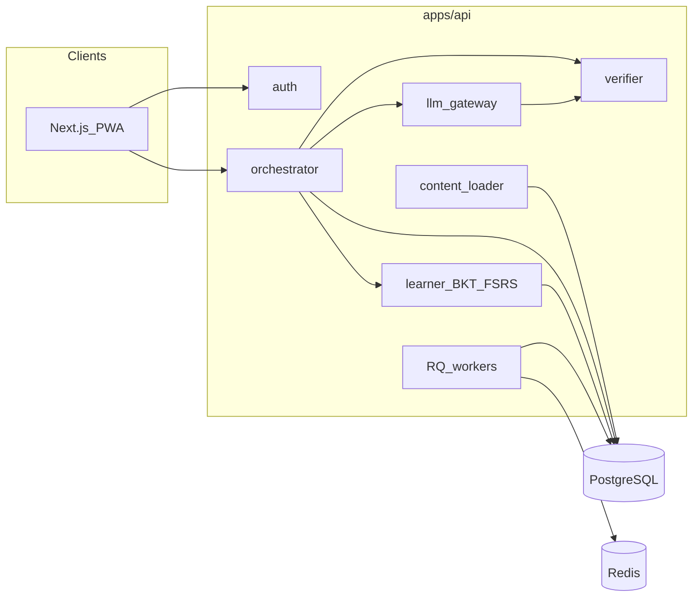
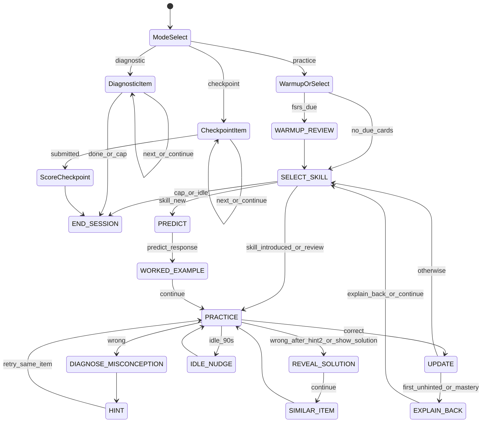
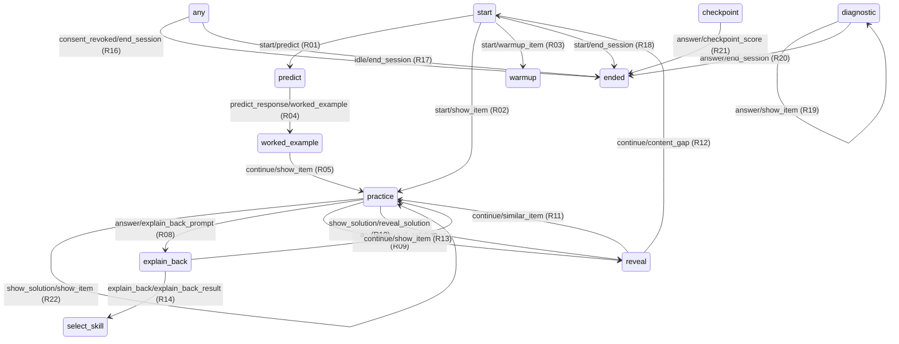
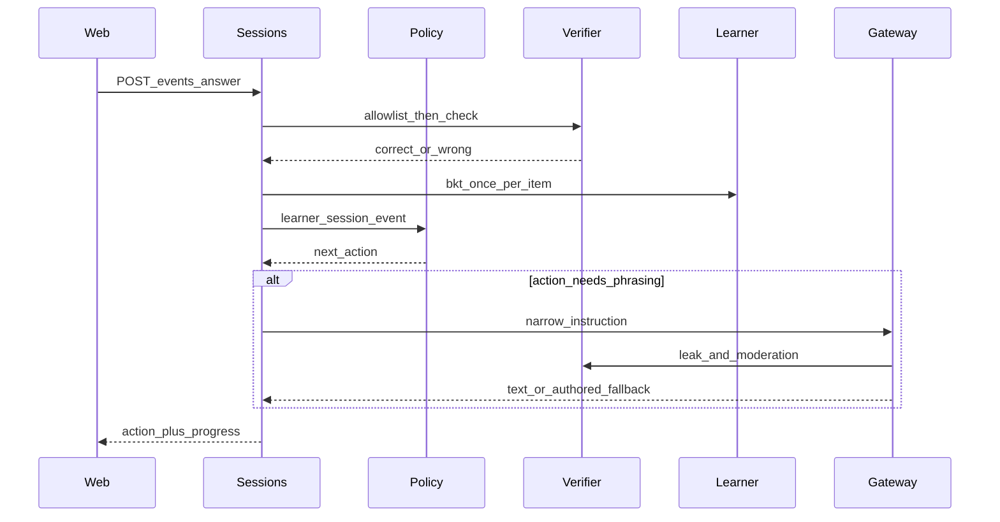

# ARCHITECTURE — Pedagogy-First AI Tutor

The orchestrator decides pedagogy. The LLM only phrases. Correctness, next skill, and answer reveal are never delegated to a model.

---

## 0. Design sources

| Decides | Source of truth | Section |
|---------|-----------------|---------|
| How the tutor behaves (tone, escalation, ask-before-tell) | **`docs/TUTOR_CONSTITUTION.md`** | — |
| WHAT is taught | Approved content + curriculum context | §17 |
| HOW it is taught (transitions, guardrails) | Deterministic `policy()` + rule ids | §8–§10 |
| HOW it is personalised | Learner model (BKT, FSRS, mastery) | §11 |
| HOW it is worded | LLM gateway + grade-band style | §14 |
| WHETHER it is correct | Verifier | §13 |

If code and the constitution disagree, track the gap in PLAN.md until fixed.

---

## 1. Principles

1. **Deterministic teaching engine.** `policy(learner, session, last_event) → action` is pure and unit-tested.
2. **LLM is a phrasing layer.** It receives a narrow instruction object (purpose, item, hint level, language, forbidden answer, authored steps). It never chooses the next skill or scores an answer.
3. **Verified truth only.** The allowlist parser + SymPy / exact match / MCQ decide correctness. LLM explanations are grounded in authored solution steps. Explain-back grades are **formative only**.
4. **Same guardrails online and offline.** Shared JSON fixtures in `packages/shared/fixtures/` are contract tests for the Python orchestrator and the TypeScript offline player.
5. **Children's data.** Parent consent required (scoped). No PII in LLM prompts or `llm_calls`. Pseudonymised analytics. Parent export and delete are first-class APIs.
6. **Works without an API key.** Authored hints, solutions, and encouragement copy are always sufficient.
7. **Approved content in production.** Runtime serves `status=approved` only, unless `ALLOW_DRAFT_CONTENT=true` (dev/demo). A chapter cannot go live unless every skill meets the item thresholds in §16.
8. **Locale fallback.** Missing or placeholder translations fall back to English. Never show empty fields or unreviewed machine translations.

---

## 2. System context



**Hosting later:** AWS or GCP Mumbai (Indian data residency). Not part of MVP.

---

## 3. Repository layout

```
/
├─ PLAN.md
├─ ARCHITECTURE.md
├─ docker-compose.yml
├─ .env.example
├─ .gitattributes
├─ apps/
│  ├─ api/          FastAPI, orchestrator, verifier, learner, LLM gateway
│  └─ web/          Next.js App Router, PWA, parent/student/teacher
├─ content/         YAML skills, items, misconceptions, overlays, glossary
└─ packages/shared/ Generated OpenAPI TS types + contract fixtures
```

Python 3.12, Pydantic v2, SQLAlchemy 2, Alembic, Postgres 16 + pgvector, Redis + RQ, Next.js + TypeScript + Tailwind, next-intl, LiteLLM, SymPy, `fsrs` / `ts-fsrs`.

---

## 4. Components

| Component | Responsibility |
|---|---|
| `auth/` | OTP via `OtpSender` interface (email now; phone/WhatsApp later); PIN lockout; consent scopes; parent export/delete |
| `content/` | YAML schema, validator, loader, approved-only + live-chapter gate, locale fallback |
| `learner/` | BKT (one update per item), FSRS, mastery service; server recomputes from events on sync |
| `orchestrator/` | States, policy, guardrails, engine (pure) |
| `verifier/` | Allowlist parser (never raw `sympify`), math check, hint leak check (levels 1–2) |
| `llm/` | LiteLLM gateway, versioned prompts, safety, PII strip |
| `sessions/` | Start/resume/event/end; active-time clock; idle auto-end |
| `diagnostics/` | Placement diagnostic; seeds mastery on completion |
| `checkpoints/` | Matched forms A/B; score never updates mastery/FSRS; comparison-group link/print |
| `reports/` | Weekly parent job; email sender; WhatsApp stub |
| `teacher/` | Heatmap, stuck-now, review queue (only `teacher_share` students) |
| `analytics/` | Pseudonymised CSV export (requires `research_pseudonymised`) |
| Web offline store | IndexedDB packs (offline-verifiable items only), TS BKT + ts-fsrs, event queue |

---

## 5. Session modes

| Mode | Hints | Reveal | LLM | Mastery / FSRS | Item pool |
|---|---|---|---|---|---|
| `practice` | Levels 1–2 after wrong or 60 s | After the attempt **following hint 2** is wrong, or `show_solution` after 2 hints. Hint 3 is the `reveal_solution` lead-in only | Phrasing only (if `ai_processing`) | One BKT update per item (first answer or first hint request) | `practice` only |
| `diagnostic` | No | No | No | **On completion**, seed initial `p_known` per skill from results | `diagnostic` only |
| `checkpoint` | No | No | No | **Never** — scoring does not update mastery or FSRS | form A or B from `checkpoint_forms` |

Checkpoint items are never in teaching, practice selection, or offline packs. Diagnostic and checkpoint are **separate session types** (see §6.3).

---

## 6. Orchestrator state machine

Input: learner state + session state + last event. Output: next action. No I/O inside `policy()`.



<!-- ORCH_TRANSITIONS:START -->

<!-- ORCH_TRANSITIONS:END -->

### 6.1 Practice transitions (normative)

1. **HINT → PRACTICE (retry)** after hint **level 1 or 2**. Student retries the **same item**. Hint **level 3 is never a retry hint**; it is the lead-in sentence of `reveal_solution` (then the authored solution steps).
2. **Exactly one BKT update per item**, at the **first answer or first `request_hint`**, whichever comes first (see §8). A later hinted-correct only increments `mastery.hinted_correct`.
3. **EXPLAIN_BACK is conditional, once per skill:** after the first **unhinted** correct on that skill, **or** when the skill reaches mastery on this update. Otherwise `UPDATE → SELECT_SKILL`. The LLM grade is formative and **does not** change mastery or FSRS. `continue` skips the text box.
4. **PREDICT and WORKED_EXAMPLE only if the skill is new.** Client sends `predict_response` to leave PREDICT, then `continue` to leave WORKED_EXAMPLE. Introduced/review skills: `SELECT_SKILL → PRACTICE`.
5. **Skip WARMUP_REVIEW** when no FSRS card has `due_at ≤ now`. When due, at most 3 review items, then `SELECT_SKILL`.
6. **Session caps after every completed item** (see §7). Clock is **active time only**. Soft: 15 min active or 12 items. Hard: 20 min active — finish the current item, then `END_SESSION`. **10 min idle → auto-end**; session is **resumable**.
7. **Unmatched wrong answers** use the generic authored hint ladder **levels 1–2**. Matched `when_answer_equals` attaches `misconception_id`.
8. **IDLE_NUDGE** (90 s on the current item) does not change pedagogy. After **10 min** idle the session auto-ends (resumable).
9. **Reveal** after hint 2 is shown and the student retries: if that attempt is also wrong, or they send `show_solution` after 2 hints. `reveal_solution` text = hint 3 (lead-in) + full worked solution. Then `continue` → `SIMILAR_ITEM`. Levels 1–2 never leak the answer.
10. **`SIMILAR_ITEM`** is a **different** approved `pool: practice` item with the **same primary skill and the same difficulty tier**. Never reuse the item that was just revealed. If no other item exists in-tier, use the nearest populated tier on that skill. If still none, log a `content_gap` event (skill, tier, item ids seen), stop work on that skill for the session, and `SELECT_SKILL`.
11. **Consent revoked mid-session:** on the **next** `POST /sessions/{id}/events` (or sync), end the session (`ended_reason=consent_revoked`). Do **not** apply further pedagogy and make **no further LLM calls**.

A skill is **new** if the student has never been shown an item for it in any practice session. Warm-up review items are not "new."

### 6.2 Skill selection (practice, v1 rules)

**Current chapter target**

- The student (or session plan) has a `chapter_id` that maps to one overlay chapter (board + grade + ordered `skill_ids`).
- Let **T** (the current chapter target skill) be the **first skill in that overlay order** with `p_known < 0.95`. If every skill in the chapter is mastered, the session ends or the parent/teacher assigns the next chapter — do not invent a new chapter.
- Prerequisite checks and "next skill" are relative to **T** and that same ordered list.

**Policy order**

1. Due FSRS reviews first (max 3, session start only — the warm-up).
2. Else the **lowest-mastery prerequisite of T** with `p_known < 0.6`.
3. Else **T** itself if `p_known < 0.95` (which it is, by definition of T).
4. Never pick `pool: checkpoint` or `pool: diagnostic` in practice.

**Item selection (tiers)**

Authored `difficulty` is an **ordinal only** (which band an item sits in, and order within that band). It is not a probability and is not used in a predicted-success formula.

1. Choose a **tier from the student's `p_known`** on the skill being practised:
   - `p_known < 0.4` → **easy**
   - `0.4 ≤ p_known ≤ 0.8` → **medium**
   - `p_known > 0.8` → **hard**
2. Map items to the same three bands using authored difficulty: `[0, 0.4)` easy, `[0.4, 0.8]` medium, `(0.8, 1]` hard.
3. Among **eligible** items in that tier (approved, `pool: practice`, correct skill, not yet shown this session if others remain), pick the **least-recently-shown** for this student (never shown → first).
4. If the tier is empty, fall back to the nearest populated tier (prefer the easier neighbour).

**Post-pilot (do not build now):** recalibrate authored difficulty from empirical unhinted correct rates so band boundaries match observed success. Track as a PLAN.md later task.

### 6.3 Diagnostic and checkpoint loops

- Linear item sequence. No hint, no reveal, no LLM. Client uses `answer` and `continue`.
- **Diagnostic:** record answers. On **completion**, seed initial `mastery.p_known` per skill (BKT batch from those first attempts).
- **Checkpoint:** serve form A or B from `checkpoint_forms`. Score into `checkpoint_results` only. **Never** update mastery or FSRS.
- **Comparison group:** a participant must exist in `study_participants` with `group=comparison`, a logged parental `consent_ref`, and `assignment_method` recorded (random assignment is the default and must be stored). Then a **single-form, expiring, PII-free** token may be issued. `GET /checkpoints/{id}/forms/{A|B}` with that token (or a printable view) — no tutor session, no hints, no student account. Tokens cannot be issued without the consent row.

---

## 7. Session length

The clock counts **active time only**:

```
active_ms = sum(min(event.latency_ms, 5 * 60 * 1000))
```

Each event's `latency_ms` is capped at **5 minutes** before being added. Do not use heartbeats. Idle gaps (no events) are not added. Wall-clock since `last_active_at` ≥ **10 minutes** → auto-end (`ended_reason=idle`). The row stays **resumable**: `POST /sessions` with the same student + open/idle session id resumes at the last action.

Checked **after every completed item**:

| Cap | Rule |
|---|---|
| Soft | `active_ms ≥ 15 min` **or** 12 items completed → `END_SESSION` ("done for today") |
| Hard | `active_ms ≥ 20 min` → finish the **current** item, then `END_SESSION` |
| Idle | 10 min with no events → auto-end; student may resume |

No endless feed. Today screen shows remaining active minutes. No ranks, no streak-loss threats.

---

## 8. Learner model

### BKT

Per skill parameters from content (`p_init`, `p_learn`, `p_slip`, `p_guess`).

BKT updates apply to the item's **primary skill only** (first entry of `skill_ids`). The validator requires every item to have at least one skill.

**Exactly one BKT update per item**, at the first of:

- first `answer`, or
- first `request_hint`

| First event on the item | Event log | BKT evidence | Later hinted-correct |
|---|---|---|---|
| Unhinted correct `answer` | `correct=true`, `outcome=unhinted` | Correct | n/a |
| Wrong `answer` | `correct=false` | Incorrect | increment `mastery.hinted_correct` only — **no second BKT update** |
| `request_hint` before any answer | `hint` | Incorrect | increment `mastery.hinted_correct` only — **no second BKT update** |

Do not apply BKT again when the student later answers correctly after hints. Mastered: `p_known ≥ 0.95` **and** ≥ 3 unhinted corrects.

Keep a `MasteryModel` interface so a learned model can replace BKT later.

On **offline sync**, the server **recomputes** mastery (and FSRS) from the canonical event log. The client may run BKT/`ts-fsrs` locally for UX; the server log wins.

### FSRS

One `review_cards` row per `(student, skill)`.

- **Warm-up items:** the outcome updates **that skill's** FSRS card **immediately** (Again / Hard / Good / Easy from correctness, hints used, latency).
- **All other practised skills:** **one** FSRS rating at **session end**, derived from that session's **unhinted-correct rate** on the skill (e.g. 0 → Again, (0, 0.5] → Hard, (0.5, 0.85) → Good, ≥ 0.85 → Easy).
- Explain-back grades and checkpoint scores do **not** update FSRS. `due_at` drives warm-up.

---

## 9. Verifier

**Never call `sympify` (or equivalent) on raw student input.**

1. **Normalise** (before parse): Devanagari digits `०–९` and Bengali/Assamese digits `০–৯` → ASCII `0–9`; Unicode minus (`−`, `–`) → `-`; multiplication (`×`, `·`) → `*`; collapse spaces; accept forms like `x = 5` / `x=5` as the RHS (or the whole equation vs authored `sympy`).
2. **Allowlist parser:** only digits, `.`, `+`, `-`, `*`, `/`, `^`, parentheses, and a small set of symbols (`x`, `y`, `z` and authored variable names). Max length **64** characters after normalise. Parse timeout **50 ms**. Reject anything else (functions, `__`, letters outside the symbol set, commas as code, etc.).
3. **Then** (on the parsed tree only) symbolic equivalence + numeric tolerance, or membership in `answer.accept`.
4. **mcq:** exact option id.
5. **short_text:** authored accept list. Explain-back uses an LLM rubric for **formative feedback only** — it does not decide item correctness and **never** changes mastery or FSRS.
6. **hint_leak_check:** string match + equivalence on numbers/expressions in hint **levels 1–2** vs the forbidden answer. Level 3 is reveal lead-in and is not leak-checked as a hint. Generated leak → regenerate once → authored fallback.
7. **Author-time:** validator requires the last `solution_steps` entry to be equivalent to `answer.sympy` (see §16).

Tests must include malicious strings (`__import__`, `os.system`, very long input, nested parentheses bombs).

Offline TS verifier: **numeric, exact, and accept-list only** (same normaliser + allowlist). Items that need symbolic server-side checking are **excluded from offline packs**.

---

## 10. LLM gateway

One function per purpose: `personalise_hint`, `adapt_explanation`, `grade_explain_back`, `encourage`. Versioned templates in `llm/prompts/<purpose>/vN.md`. JSON-only parse, timeout, one retry, cache key `(purpose, item, misconception, level, language, prompt_version)`.

Every call includes: authored solution steps, authored hint, misconception explanation (if any), glossary for the language, word limit, forbidden answer.

Post-checks before the student sees text: schema → leak (hints 1–2) → length → moderation → language. Failure → regenerate once → authored fallback. Log to `llm_calls` (no raw PII). Sample into `review_queue` (100% first pilot week, then 20%, configurable).

**`grade_explain_back` is formative only.** Persist the grade on the event payload for the teacher/parent view. It **must not** write `mastery` or `review_cards`.

**Explain-back fallback** (no `ai_processing` scope, or no API key): store the student's text on the event, show the **authored model explanation**, and **give no grade**. Still no mastery/FSRS effect.

**No LLM calls** in diagnostic or checkpoint modes, when `ai_processing` is not granted, or when no API key is configured.

---

## 11. Offline and contract tests

Offline pack (`GET /content/packs/{overlay}/{chapter}`):

- Skills + **offline-verifiable** practice items only: `type` in `numeric` | `mcq` | accept-list `short_text` (and numeric-like `expression` only if `answer.accept` is sufficient without SymPy).
- Authored hints 1–2 and solutions.
- **Excludes** checkpoint items, symbolic-only items, and drafts (unless `ALLOW_DRAFT_CONTENT`).

The TypeScript offline player includes:

- the same orchestrator policy
- BKT (one update per item, same rules as §8)
- `ts-fsrs` for local due dates

Events queue in IndexedDB and sync via `POST /sync/events` (idempotent on `client_event_id`).

**Server is the source of truth on sync:**

1. Re-verify **every** `answer` from the stored `payload.response` using the allowlist verifier.
2. **Ignore** any client-supplied `correct` flag (do not persist it; overwrite from the verifier).
3. Recompute mastery and FSRS from the canonical event log.
4. **Reject** (HTTP 422, nothing applied) or **flag** (`events.payload.guardrail_flag`) sequences that violate teaching guardrails — e.g. `reveal` / `show_solution` before the attempt following hint 2, hint 3 returned as a retry hint, checkpoint item in a practice session. Contract tests live in `packages/shared/fixtures/sync_guardrails/`.

**Fixtures:** `packages/shared/fixtures/*.json` run in Python and TypeScript. A mismatch is a CI failure.

---

## 12. Data model (PostgreSQL)

pgvector is enabled; not used heavily in MVP.

### 12.1 `users`

| Column | Type | Notes |
|---|---|---|
| id | uuid pk | |
| role | enum | `parent` \| `teacher` \| `admin` |
| email | text unique | |
| locale | text | `en` \| `ne` \| `as` |
| created_at | timestamptz | |

### 12.2 `students`

| Column | Type | Notes |
|---|---|---|
| id | uuid pk | |
| parent_id | fk users | |
| display_name | text | |
| grade | int | |
| board | enum | `bhutan` \| `seba` |
| home_language | enum | `en` \| `ne` \| `as` |
| exam_language | enum | `en` \| `ne` \| `as` |
| exam_date | date nullable | |
| current_chapter_id | text nullable | overlay chapter; defines T in §6.2 |
| pin_hash | text | |
| pin_failed_attempts | int | reset on success; lock at 5 |
| pin_locked_until | timestamptz nullable | |
| timezone | text | `Asia/Thimphu` or `Asia/Kolkata` |
| created_at | timestamptz | |

Defaults: Bhutan → `Asia/Thimphu`; SEBA → `Asia/Kolkata`. PIN lockout: 5 failures → `pin_locked_until` (15 minutes).

### 12.3 `consents`

| Column | Type | Notes |
|---|---|---|
| id | uuid pk | |
| student_id | fk students | |
| parent_id | fk users | |
| version | text | Plain-language consent version |
| scopes | text[] | subset of `tutoring`, `teacher_share`, `research_pseudonymised`, `ai_processing` |
| granted_at | timestamptz | |
| revoked_at | timestamptz nullable | Active iff `revoked_at IS NULL` |

`tutoring` is required to start a session. Teachers only see students whose active consent includes `teacher_share`. Analytics export requires `research_pseudonymised`. LLM phrasing requires `ai_processing`; otherwise authored fallback only.

### 12.4 `classes`

| Column | Type | Notes |
|---|---|---|
| id | uuid pk | |
| teacher_id | fk users | |
| name | text | |
| board | enum | |
| created_at | timestamptz | |

### 12.5 `class_memberships`

| Column | Type | Notes |
|---|---|---|
| class_id | fk classes | composite pk |
| student_id | fk students | composite pk |

### 12.6 `skills`

Mirrors YAML: id (text pk), titles JSON, grade_band, subject, bkt params, status.

### 12.7 `skill_edges`

| Column | Type | Notes |
|---|---|---|
| from_skill | fk skills | |
| to_skill | fk skills | |
| type | enum | `prereq` \| `related` |

### 12.8 `misconceptions`

id, titles JSON, explanation JSON, remedial_skill.

### 12.9 `items`

id, difficulty, type (`expression` \| `numeric` \| `mcq` \| `short_text`), pool (`practice` \| `diagnostic` \| `checkpoint`), stem JSON, answer JSON, solution_steps JSON, hints JSON (exactly 3 levels; 3 = reveal lead-in), prediction_prompt JSON, misconception_rules JSON, status, reviewed_by. `skill_ids` via `item_skills` (order preserved). **Primary skill** = first `skill_ids` entry; required; BKT updates that skill only.

### 12.10 `item_skills`

`(item_id, skill_id)` many-to-many.

### 12.11 `glossary_terms`

term key, language, translation. Used in every LLM prompt.

### 12.12 `overlays`

id, board, grade, chapter, ordered skill_ids JSON, `live` bool (set only if §16 thresholds pass).

### 12.13 `mastery`

| Column | Type | Notes |
|---|---|---|
| student_id | fk | composite pk |
| skill_id | fk | composite pk |
| p_known | float | |
| attempts | int | items that triggered a BKT update |
| unhinted_correct | int | |
| hinted_correct | int | counter only; not a BKT update |
| last_updated | timestamptz | |

### 12.14 `review_cards`

| Column | Type | Notes |
|---|---|---|
| student_id | fk | composite pk |
| skill_id | fk | composite pk |
| fsrs_state | jsonb | package state |
| due_at | timestamptz | |

### 12.15 `sessions`

| Column | Type | Notes |
|---|---|---|
| id | uuid pk | |
| student_id | fk | |
| started_at | timestamptz | |
| ended_at | timestamptz nullable | |
| ended_reason | text nullable | `soft_cap` \| `hard_cap` \| `idle` \| `complete` \| `user` |
| resumable | bool | true after idle auto-end until a new session type starts |
| type | enum | `practice` \| `diagnostic` \| `checkpoint` |
| active_ms | int | active time only |
| last_active_at | timestamptz | |
| plan | jsonb | chapter_id, selected skills/items, caps |

### 12.16 `events` (append-only)

| Column | Type | Notes |
|---|---|---|
| id | uuid pk | |
| client_event_id | uuid unique nullable | idempotency for sync |
| session_id | fk | |
| item_id | text nullable | |
| event_type | text | see §13 |
| payload | jsonb | see §13 |
| correct | bool nullable | |
| hint_level | int nullable | 1 or 2 for retry hints |
| latency_ms | int nullable | counts toward `active_ms` |
| created_at | timestamptz | |

### 12.17 `misconception_hits`

student_id, misconception_id, item_id, created_at.

### 12.18 `llm_calls`

id, purpose, prompt_version, model, input_tokens, output_tokens, latency_ms, cost_estimate, verification_status, leaked, fallback_used, created_at. **No raw PII or student names.**

### 12.19 `review_queue`

llm_call_id, status (`pending` \| `approved` \| `edited` \| `rejected`), reviewer_id, edited_text.

### 12.20 `checkpoint_results`

student_id, checkpoint_id, form (`A` \| `B`), score, per_skill JSON, taken_at. Scoring **does not** write mastery or FSRS.

### 12.21 `reports`

student_id, week_start, payload JSON, sent_via, sent_at.

### 12.22 `checkpoint_forms`

| Column | Type | Notes |
|---|---|---|
| id | uuid/text pk | |
| checkpoint_id | text | chapter-level checkpoint |
| form | enum | `A` \| `B` |
| item_ids | jsonb | ordered held-out items |
| match_map | jsonb | A-item id → matched B-item id (same skill, isomorphic) |

Each checkpoint has **two matched forms**. Hard minimum **10** items per form (`match_map` complete). Validator **warns** below **15**. Trials should use **15–20** items per form.

### 12.23 `study_participants`

| Column | Type | Notes |
|---|---|---|
| id | uuid pk | |
| student_id | fk nullable | tutor-arm students only |
| pseudonymous_code | text unique | no name, phone, or school |
| group | enum | `tutor` \| `comparison` |
| consent_ref | fk consents | **required** before any token |
| assigned_at | timestamptz | |
| assignment_method | text | `random` (default; must be recorded) \| `stratified` \| other documented method |
| site_id | text | within-site randomisation; seed stored on the row |
| assignment_seed | text | recorded RNG seed |
| pretest_form / posttest_form | `A`/`B` | tutor arm: opposite forms; comparison: one assigned form |

### 12.24 `checkpoint_tokens`

| Column | Type | Notes |
|---|---|---|
| id | uuid pk | |
| participant_id | fk study_participants | `group=comparison` |
| form | enum | `A` \| `B` — **one form only** |
| token_hash | text | raw token never stored with PII |
| expires_at | timestamptz | short-lived |
| issued_at | timestamptz | |

A token is issued only after `consent_ref` is logged. The token string contains no PII (random opaque id). Expired tokens cannot load a form.

---

## 13. Event API schema

`POST /sessions/{id}/events`

Requires active consent with `tutoring`. Diagnostic/checkpoint reject `request_hint`, `explain_back`, `show_solution`, and any reveal.

### 13.1 Request

```json
{
  "client_event_id": "550e8400-e29b-41d4-a716-446655440000",
  "event_type": "answer",
  "item_id": "ITEM.LIN1.0001",
  "payload": {}
}
```

| Field | Type | Required | Notes |
|---|---|---|---|
| client_event_id | uuid | yes | Idempotent replay (offline sync) |
| event_type | enum | yes | `answer` \| `request_hint` \| `explain_back` \| `idle_nudge` \| `show_solution` \| `predict_response` \| `continue` |
| item_id | string | yes except session-level | Must match the current item when applicable |
| payload | object | yes | Discriminated by `event_type` |

**`answer` payload**

| Field | Type | Notes |
|---|---|---|
| response | string | Student input (normalised server-side; never raw `sympify`) |
| latency_ms | int | Added as `min(latency_ms, 5 min)` to `active_ms` |

**`request_hint` payload**

| Field | Type | Notes |
|---|---|---|
| latency_ms | int | |
| after_wrong | bool | Hint button: after a wrong answer or 60 s |

Server assigns hint level **1 or 2** only. First `request_hint` on an item with no prior answer triggers the item's **one** BKT update (incorrect). Reject in diagnostic/checkpoint.

**`explain_back` payload**

| Field | Type | Notes |
|---|---|---|
| text | string | Short "why does this work?" |
| language | string | Student's home language |

Grade is formative only.

**`idle_nudge` payload**

| Field | Type | Notes |
|---|---|---|
| idle_ms | int | Client timer; fire at ≥ 90000 |

**`show_solution` payload**

| Field | Type | Notes |
|---|---|---|
| latency_ms | int | Reject unless ≥2 retry hints already given |

**`predict_response` payload**

| Field | Type | Notes |
|---|---|---|
| text | string | Prediction; not scored for mastery |
| latency_ms | int | Advances PREDICT → WORKED_EXAMPLE |

**`continue` payload**

| Field | Type | Notes |
|---|---|---|
| latency_ms | int | Advances WORKED_EXAMPLE → PRACTICE, REVEAL → SIMILAR_ITEM, EXPLAIN_BACK skip, diagnostic/checkpoint next |

### 13.2 Response

```json
{
  "session_id": "…",
  "duplicate": false,
  "action": {
    "type": "hint",
    "item_id": "ITEM.LIN1.0001",
    "hint_level": 1,
    "misconception_id": "MC.ALG.INVERSE_OP_WRONG_SIDE",
    "text": "What operation is being done to x?",
    "source": "authored",
    "language": "en"
  },
  "progress": {
    "items_completed": 4,
    "active_ms": 540000,
    "soft_end": false,
    "hard_end": false,
    "resumable": false
  }
}
```

**`action.type` values**

| type | When |
|---|---|
| `warmup_item` | Due review item |
| `predict` | New skill prediction prompt; wait for `predict_response` |
| `worked_example` | After `predict_response`; wait for `continue` |
| `show_item` | Practice / diagnostic / checkpoint item |
| `feedback` | Immediate correct/wrong feedback (always on wrong) |
| `hint` | Level 1 or 2; then retry same item |
| `reveal_solution` | Hint 3 lead-in + full solution; wait for `continue` |
| `similar_item` | After reveal `continue` |
| `explain_back_prompt` | Conditional, once per skill; `explain_back` or `continue` |
| `nudge` | After `idle_nudge` |
| `end_session` | Soft/hard cap, idle, or mode complete |
| `checkpoint_score` | After checkpoint submit (no mastery write) |

If `client_event_id` already exists, return the original response with `duplicate: true`.

### 13.3 Server-written events

The engine also appends `shown`, `hint`, `reveal`, `nudge` as it acts.

---

## 14. Request flows

### 14.1 Practice turn (online)



### 14.2 Session start and resume

`POST /sessions` `{ type, student_id }` → refuse if no active `tutoring` consent → if a resumable session of that type exists, resume it → else create session → policy initial action.

### 14.3 Offline sync

Download pack (offline-verifiable items only) → local policy + BKT + ts-fsrs → queue events → `POST /sync/events`. Server **re-verifies every answer** from `payload.response`, **ignores client `correct`**, rejects or flags illegal sequences, recomputes mastery/FSRS from the log, returns canonical learner state.

---

## 15. HTTP API (minimum)

| Method | Path |
|---|---|
| POST | `/auth/request-otp` |
| POST | `/auth/verify-otp` |
| POST | `/students` |
| GET | `/students/{id}` |
| POST | `/students/{id}/consent` |
| GET | `/parents/me/export` |
| DELETE | `/parents/me` |
| POST | `/sessions` |
| POST | `/sessions/{id}/events` |
| POST | `/sessions/{id}/end` |
| GET | `/students/{id}/progress` |
| GET | `/content/packs/{overlay}/{chapter}` |
| POST | `/sync/events` |
| GET | `/teacher/classes/{id}/heatmap` |
| GET | `/teacher/classes/{id}/stuck` |
| GET | `/teacher/review-queue` |
| POST | `/teacher/review-queue/{id}` |
| GET | `/checkpoints/{id}/forms/{form}` |
| GET | `/analytics/export` |

OpenAPI → generated TS types in `packages/shared` (`packages/shared/openapi.yaml`).

### 15.1 Session action payload (web player)

Every `GET /sessions/{id}` and `POST /sessions/{id}/events` response includes an enriched `action` object for the student UI.

| Field | Meaning |
|---|---|
| `can_request_hint` | Orchestrator will accept `request_hint` on this action (practice only; not diagnostic/checkpoint). |
| `can_show_solution` | Orchestrator will accept `show_solution` (after two hint levels have been shown). |
| `allow_hint` | Deprecated alias of `can_request_hint`. |
| `hint_level_shown` | Hint levels already delivered this item (0–2). |
| `dont_know_option` | Show “I don’t know” (diagnostic-style items). |

Action `type` values include: `warmup_item`, `predict`, `worked_example`, `show_item`, `feedback`, `hint`, `reveal_solution`, `similar_item`, `explain_back_prompt`, `explain_back_result`, `nudge`, `content_gap`, `end_session`, `checkpoint_score`.

- **`content_gap`:** No teachable items remain for the current chapter; client should return to Today (not an error).
- **`explain_back_result`:** Formative explain-back complete; shows authored feedback text (and optional LLM grade only when `ai_processing` is consented). Does not change mastery or FSRS.

The web client must not infer hint or reveal availability from `hint_level_shown` alone; use `can_request_hint` and `can_show_solution`. Optional hint delay timers are presentation-only.

---

## 16. Content pipeline

YAML in `content/` → `python -m app.content.validate` → `python -m app.content.load`.

Validator: unique IDs, refs resolve, no prerequisite cycles, every practice item has **3 hint levels** (1–2 = retry, 3 = reveal lead-in) and solution steps, checkpoint items not referenced by any practice set, answers parse through the **allowlist**, final solution step equivalent to stated answer, leak check on hint levels 1–2.

**Content gate (runtime):** serve `status=approved` only, unless `ALLOW_DRAFT_CONTENT=true` (dev/demo).

**Live-chapter threshold** (all must hold for `overlays.live = true`):

| Rule | Minimum |
|---|---|
| Approved **practice** items per skill in the chapter | **5** |
| Approved **diagnostic** items per skill | **2** |
| Matched checkpoint forms A and B | both present |
| Approved checkpoint items per form | Hard min **10** (fail below). **Warn** below **15**. Trials: **15–20**. `match_map` complete. |

A chapter that fails this stays not-live. Practice sessions cannot target it in production. Seed content ships `draft` until Track B approval plus these counts.

**Locale fallback:** `requested locale → en`. Empty strings and reviewer placeholders count as missing.

---

## 17. Auth, consent, quiet hours

OTP delivery is behind `OtpSender.send(destination, code)`. MVP: `EmailOtpSender` (log-to-console when SMTP unset). Later: `WhatsAppOtpSender` / `SmsOtpSender` without changing routes.

Rate-limit `request-otp` and `verify-otp` per destination and per IP. Student PIN: lockout after 5 failures.

No session without active consent that includes `tutoring`. Quiet hours **21:00–07:00** in `students.timezone`.

Parent export/delete as before.

### 17.1 Role / authorization matrix

| Action | Parent | Student (PIN) | Teacher | Admin | Comparison token |
|---|---|---|---|---|---|
| Request/verify OTP | own email | — | own email | own email | — |
| Create student, consent, PIN | own children | — | — | yes | — |
| Start/resume practice or diagnostic | — | self, `tutoring` | — | yes | — |
| Take checkpoint in tutor | — | self, `tutoring` | — | yes | — |
| Take checkpoint via link/print | — | — | — | issue token | that form only |
| See progress / reports | own children | self | class + `teacher_share` | yes | — |
| Export / delete family data | self + children | — | — | yes | — |
| Heatmap / stuck / review queue | — | — | class + `teacher_share` | yes | — |
| Analytics CSV | — | — | — | `research_pseudonymised` students | — |
| LLM phrasing | — | if `ai_processing` | — | if granted | never |
| Load draft content | if `ALLOW_DRAFT_CONTENT` | same | same | same | no |

Teachers **never** see a student whose parent did not grant `teacher_share`, even if the student is in the class roster.

---

## 18. Child safety

- Strip names, phone, email, school before any LLM call (`llm/pii.py`).
- Moderation on input and output.
- No open-ended chat outside the current item.
- Distress keywords → authored gentle script + flag for parent/teacher. The model does not counsel.
- Human review queue samples AI messages.

---

## 19. Frontend surfaces

- **Parent:** OTP, add student, scoped consent, weekly progress, data export/delete, `en`/`ne`/`as` with English fallback.
- **Student:** PIN, Today, session player (`predict_response`, `continue`, hint 1–2, reveal with hint-3 lead-in), done-for-today, resume after idle. Hint button after wrong or 60 s. Idle nudge at 90 s.
- **Teacher:** heatmap / stuck / review queue for `teacher_share` students only.
- **Comparison checkpoint:** plain page or printable form A/B, no tutor chrome.
- Mobile-first PWA, 360 px Android, large tap targets, low data.

---

## 20. Observability

Structured JSON logs. Every LLM call → `llm_calls`. Pilot metrics in PLAN.md.

---

## 21. Extension points (do not build now)

| Later | Hook |
|---|---|
| Flutter / WhatsApp / voice | Session event API is channel-agnostic |
| Phone / WhatsApp OTP | New `OtpSender` implementation |
| Learned policy | Replace `policy()`; keep the action schema |
| Learned mastery | `MasteryModel` interface |
| Dzongkha | Another locale + glossary file |
| Payments / extra boards | New overlay YAML + billing service |
| pgvector | Already enabled for future retrieval |

---

## 22. Local infrastructure

`docker-compose`: `postgres` (16, pgvector), `redis`, `api`, `web`.

Windows: Docker Desktop + WSL2; repository on the WSL filesystem. See README / PLAN.md. `.gitattributes` forces LF.

`.env.example` sets `ALLOW_DRAFT_CONTENT=true` for local compose. Production must leave it unset/false.

---

## 23. Track B (non-code)

See PLAN.md. Teachers approve seed YAML; a parallel manual WhatsApp pilot (30–50 families) supplies real mistakes that replace placeholder misconceptions and items. Engineering only lands those as validated YAML — never as unreviewed machine translation marked `approved`. Live-chapter thresholds still apply after approval.
